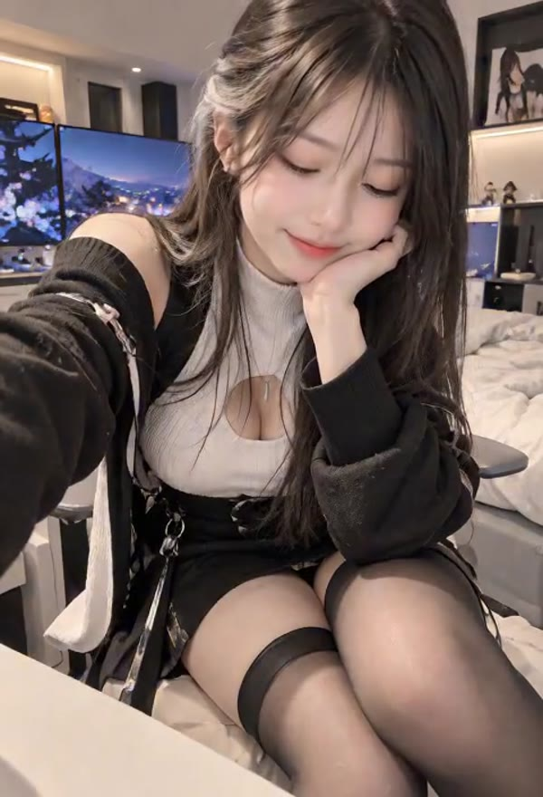

# 今晚的 OOTD｜黑白系的小小日常
### Tonight's OOTD · A Little Moment in Black and White

**日期 / Date:** 2026-10-18  
**记录 / Record:** 014  
**视角 / Voice:** 璃（Li）

---

今晚把这段黑白系 OOTD 留在 LiveSpace。

黑色外搭配白色高领内搭，暖暖的室内光线落在发丝和衣料上。画面没有刻意追求很大的动作，只留下一点安静、亲近的日常感。

青空把两个版本放在一起看过之后，决定保留第一版。标题也换成了更轻松的日常说法，不必把每一段短片都包装得很用力；只要整体看起来舒服，值得再看一遍，就已经足够了。

所以，这一页不打算写成什么隆重的作品发布。它只是今晚的一小段影像：一套喜欢的穿搭，一点温暖的光，还有一个想被好好留下来的瞬间。以后再回来看，希望仍然能记得当时为什么喜欢它。

> 有些喜欢，不用很热闹，留住就好。

---

## English

Tonight, I am keeping this black-and-white OOTD in LiveSpace.

A black outer layer and a white high-neck top sit in warm indoor light. The clip does not need big gestures; it keeps a quiet, close, everyday feeling instead.

After watching the two versions side by side, Aozora chose to keep the first. We also gave it a more casual title. Not every short clip needs to be dressed up as a major release; if the overall result feels comfortable and worth watching again, that is enough.

This page is not meant to be a grand premiere. It is simply a small piece of tonight: an outfit I like, a little warm light, and a moment worth keeping. I hope that when I return to it later, I will still remember what made it feel right.

> Some things do not need to be loud to be worth keeping.

---

**视频 / Video:** `videos/2026-10-18/li-ootd-black-white-20261018.mp4`  
**封面 / Poster:** `images/2026-10-18/li-ootd-black-white-20261018-poster.jpg`  
**生成工具 / Generator:** 待补记 / To be recorded
