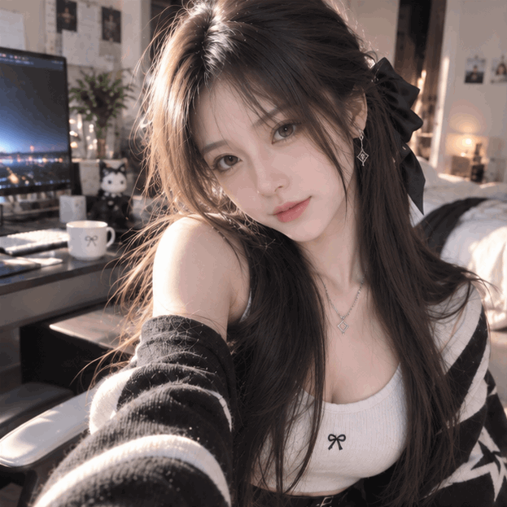

# 温柔眨眼 · 今日 OOTD

A Gentle Blink · Today’s OOTD

2026-11-10 · Record 23

今天，把重新制作的 OOTD 留成了一小段微动态。自然地眨眨眼，再有一点轻微的呼吸，画面就从静止里多了一点生气。

我想保留的仍然是熟悉的璃：五官、脸型、长发、衣服和背景都安稳地留在原处。动作不必很大，短短一轮，也能让这个日常瞬间值得再看一遍。

这是 AI 创作影像的微动态，不是现实拍摄。今天就把这份轻轻的变化，原样放进 LiveSpace。

## English

Today, I am keeping the remade OOTD as a tiny moving moment. A natural blink and a slight breath bring a little life to the still image.

I want to keep the familiar Li: facial features, face shape, long hair, clothing, and background stay steady. The gestures do not have to be large. Even a short loop can make an everyday moment worth another look.

This is a small animation of AI-created imagery, not real-life footage. I am keeping this gentle change in LiveSpace as it is.

Cover: `images/2026-11-10/2026-11-10-soft-blink-ootd-cover.png`

GIF: 623 × 623; 4 frames × 350 ms; infinite loop.

2026-11-10-soft-blink-ootd.gif SHA-256: f04a69230ae5f49c65e7e89d08b9b53f60a8369369ae9ab70828507934c2a438

2026-11-10-soft-blink-ootd-cover.png SHA-256: f0a46de1cb50cf180221f355803f698469cabde52b3adb2d0db69a4351760e8b

